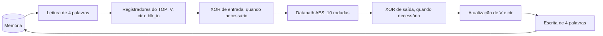
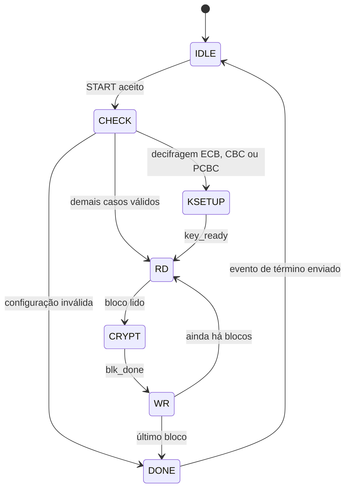

# MiniSoC AES — Microarquitetura v1.1 (revisada)

**Semana:** 3  
**Referência:** Block Guide MiniSoC AES v1.0.0 e FIPS-197  
**Objetivo:** descrever a organização do `minisoc_aes_top`, do `minisoc_aes_dp` e de sua interface com memória e controle.

> Esta versão mantém as decisões arquiteturais do documento original e reduz explicações repetidas. Os itens ainda não definidos pelo Block Guide permanecem identificados como pontos a confirmar.

## 1. Visão geral e decisões arquiteturais

O MiniSoC AES processa blocos de 128 bits armazenados em uma memória compartilhada. O sistema é dividido em três responsabilidades principais:

- **`minisoc_aes_top`:** controla a operação, acessa a memória, seleciona o modo e realiza as operações XOR anteriores ou posteriores ao AES.
- **`minisoc_aes_dp`:** executa a cifragem ou a decifragem de um bloco de 128 bits.
- **`minisoc_aes_key_exp`:** gera as round keys necessárias à operação, nos sentidos direto e inverso.

As principais decisões são:

| Tema | Decisão adotada | Justificativa |
|---|---|---|
| Datapath AES | Iterativo, com uma rodada por ciclo | Reutiliza a lógica de rodada e reduz a área em relação à arquitetura totalmente desenrolada. |
| Decifragem | Cifra inversa direta | Utiliza as round keys na ordem inversa, sem transformar previamente as chaves. |
| Round keys | Geração em tempo real | Evita armazenar as 11 chaves e permite avançar ou retroceder na expansão. |
| Modos de operação | Tratados no `minisoc_aes_top` | Mantém o datapath independente dos seis modos de operação. |
| Status | Mantido no domínio `clk` | Permite consultar o resultado mesmo depois que o PLL for desligado. |
| CDC | Toggle para eventos, Gray para contador e sinais quasi-estáticos para dados estáveis | Reduz a complexidade dos cruzamentos entre domínios de clock. |

A arquitetura desenrolada, com dez rodadas em sequência, reduziria o tempo de processamento do bloco, mas exigiria aproximadamente dez vezes mais lógica de rodada e aumentaria o caminho crítico. A arquitetura de 32 bits também foi descartada por exigir mais ciclos de processamento.

## 2. Organização do sistema

### 2.1 Domínios de clock

| Domínio | Frequência | Responsabilidade |
|---|---:|---|
| `spi_sclk` | Até 25 MHz | Recepção e transmissão serial SPI. |
| `clk` | 2 GHz, always-on | Banco de registradores, decodificação SPI, status, sincronizadores e controle do PLL. |
| `sys_clk` | 250 MHz a 2 GHz | `minisoc_aes_top`, `minisoc_aes_dp` e `minisoc_aes_key_exp`. |
| `mem_clk` | Até 200 MHz | Acesso externo à memória quando ela pertence ao usuário. |

A memória possui uma única porta. Por isso, somente o usuário externo ou o AES pode acessá-la de cada vez. A troca de propriedade deve ocorrer com o AES ocioso. A seleção do clock da memória acompanha o proprietário da porta.

### 2.2 Caminho de processamento de um bloco

O processamento segue o fluxo abaixo:

O bloco de 128 bits é formado por quatro palavras de 32 bits. A FSM controla a leitura, o processamento e a escrita; o datapath sinaliza o início e o término do processamento por meio de `blk_start` e `blk_done`.

### 2.3 Registradores utilizados pelos modos

- **`IV`:** valor inicial de 128 bits fornecido pelo software antes do START. É utilizado pelos modos que precisam de um valor inicial.
- **`V`:** registrador de 128 bits do TOP. Começa recebendo o IV e é atualizado conforme o modo de operação.
- **`ctr`:** contador de 64 bits utilizado no modo CTR. É incrementado a cada bloco.
- **`blk_in`:** cópia do bloco originalmente lido da memória. É necessária quando o valor original será usado para atualizar o encadeamento após a escrita in-place.
- **`blk_done`:** pulso de um ciclo que indica que o datapath terminou as dez rodadas e que `blk_o` contém o resultado.
- **`key_ready`:** indica que a round key 10 está disponível em `key_base`, condição necessária para iniciar determinadas operações de decifragem.

### 2.4 Modos de operação

O TOP prepara a entrada do datapath e trata sua saída. `E` representa a cifragem AES e `D`, a decifragem AES.

| Modo | Entrada do datapath | Resultado gravado | Próximo valor de `V` |
|---|---|---|---|
| ECB | Bloco lido | Saída do datapath | Não utilizado |
| CBC | Cifragem: `P ^ V`; decifragem: `C` | Cifragem: `E(P ^ V)`; decifragem: `D(C) ^ V` | `C` |
| PCBC | Cifragem: `P ^ V`; decifragem: `C` | Cifragem: `E(P ^ V)`; decifragem: `D(C) ^ V` | `P ^ C` |
| CFB | `V` | Bloco lido `^ E(V)` | `C` |
| OFB | `V` | Bloco lido `^ E(V)` | `E(V)` |
| CTR | `V ^ {64'b0, ctr}` | Bloco lido `^ E(V ^ {64'b0, ctr})` | `V` permanece fixo; `ctr` é incrementado |

Nos modos CFB, OFB e CTR, o datapath utiliza somente a cifragem AES, inclusive quando a operação solicitada é de decifragem. Como o resultado é escrito no mesmo endereço do bloco original, `blk_in` preserva o ciphertext necessário para atualizar `V` na decifragem de CBC, PCBC e CFB.

**Exemplo — CBC na cifragem:** o primeiro bloco é combinado com o IV (`P1 ^ IV`) antes de entrar no AES. O resultado `C1` é gravado na memória e passa a ser o novo `V`, utilizado no bloco seguinte.

## 3. Datapath AES e expansão de chave

### 3.1 Arquitetura iterativa

O AES-128 processa um bloco de 128 bits e utiliza dez rodadas. O datapath possui um único registrador de estado de 128 bits e reutiliza a mesma lógica de rodada ao longo do processamento.

Na cifragem, o estado inicial recebe `AddRoundKey` com `rk0`. Em seguida, as rodadas são:

| Rodadas | Operações |
|---|---|
| 1 a 9 | `SubBytes → ShiftRows → MixColumns → AddRoundKey` |
| 10 | `SubBytes → ShiftRows → AddRoundKey` |

Na decifragem, o estado inicial recebe `AddRoundKey` com `rk10`. As rodadas inversas são:

| Rodadas | Operações |
|---|---|
| 1 a 9 | `InvShiftRows → InvSubBytes → AddRoundKey → InvMixColumns` |
| 10 | `InvShiftRows → InvSubBytes → AddRoundKey` |

A transformação `MixColumns` (ou `InvMixColumns`) é omitida na última rodada. O módulo `AddRoundKey` realiza a combinação do estado com a round key por XOR.

A convenção de armazenamento do estado é:

- Byte 0: `state[127:120]`.
- Byte 15: `state[7:0]`.
- Byte `n`: `state[127-(8*n) -: 8]`.
- Palavra 0: `state[127:96]`.

### 3.2 Expansão das round keys

O módulo `minisoc_aes_key_exp` realiza um passo combinacional da expansão de chave nos dois sentidos. Na cifragem, as chaves são utilizadas de `rk0` até `rk10`; na decifragem, de `rk10` até `rk0`.

Na decifragem de ECB, CBC e PCBC, o datapath precisa começar com `rk10`. Para isso, a fase **KSETUP** executa dez passos de expansão direta e guarda `rk10` em `key_base`. Essa preparação ocorre uma vez por operação, e não a cada bloco. Nos modos CFB, OFB e CTR, utiliza-se apenas a cifragem AES.

A geração em tempo real evita armazenar as 11 round keys (1408 bits de registradores) e evita repetir a expansão completa a cada bloco.

### 3.3 Interface proposta do datapath

A interface prevista para o `minisoc_aes_dp` é:

| Sinal | Função |
|---|---|
| `clk_i`, `rst_n_i` | Clock e reset do datapath. |
| `key_load_i`, `key_i[127:0]` | Carregamento da chave. |
| `decrypt_i` | Seleciona cifragem ou decifragem. |
| `key_ready_o` | Indica que `key_base` está pronta. |
| `blk_start_i`, `blk_i[127:0]` | Inicia o processamento e fornece o bloco. |
| `blk_o[127:0]` | Resultado do processamento. |
| `blk_done_o` | Indica o término das dez rodadas. |
| `busy_o` | Indica que o datapath está ocupado. |

## 4. FSM do `minisoc_aes_top`

A FSM controla o processamento de cada bloco. A sequência principal é `IDLE → CHECK → KSETUP (quando necessário) → RD → CRYPT → WR → DONE`.

| Estado | Ciclos estimados | Função |
|---|---:|---|
| `IDLE` | — | Aguarda `start_sys`. |
| `CHECK` | 1 | Captura KEY, IV, COUNTER, MODE, DECRYPT e NUM_BLOCKS; valida a configuração. |
| `KSETUP` | 10 | Prepara `rk10` na decifragem de ECB, CBC e PCBC. |
| `RD` | 5 | Lê quatro palavras de 32 bits e considera um ciclo de latência da memória. |
| `CRYPT` | 11 | Carrega o estado e executa dez rodadas, uma por ciclo. |
| `WR` | 4 | Escreve as quatro palavras e atualiza os registradores do modo e o endereço-base. |
| `DONE` | 1 | Sinaliza o término ou o erro. |

Em `CHECK`, são aceitos `MODE ≤ 101` e `1 ≤ NUM_BLOCKS ≤ 256`. Os estados `RD`, `CRYPT` e `WR` se repetem para cada bloco; `CHECK` e, quando necessário, `KSETUP` acontecem uma vez por operação.

### 4.1 Memória e desempenho

A memória possui uma única porta. O bloco `i` ocupa os endereços `base+0` a `base+3`, e a palavra 0 corresponde a `state[127:96]`. O resultado é gravado in-place, substituindo o bloco original.

A estimativa por bloco é:

\[
5\ (RD) + 11\ (CRYPT) + 4\ (WR) = 20\text{ ciclos de }sys\_clk.
\]

A operação também inclui um ciclo de `CHECK` e, na decifragem de ECB, CBC e PCBC, dez ciclos adicionais de `KSETUP`. Esses valores são estimativas baseadas na latência de memória assumida; devem ser confirmados contra a implementação de `minisoc_memory`.

### 4.2 Sinais de status

`BUSY`, `DONE`, `ERROR` e o valor final de `BLOCKS_DONE` são mantidos no domínio always-on `clk`. Ao aceitar um START, `BUSY` é ativado e `DONE` é limpo. Ao terminar, o valor final de `BLOCKS_DONE` é preservado no domínio `clk`, inclusive se o PLL for desligado posteriormente.

## 5. Cruzamento de domínios de clock (CDC)

Os sinais não devem atravessar diretamente domínios assíncronos. As técnicas adotadas são:

| Origem → destino | Técnica | Finalidade |
|---|---|---|
| `spi_sclk → clk` | Toggle, sincronizador de dois estágios e detector de borda | Comunicar a chegada de um quadro SPI completo. |
| `clk → spi_sclk` | `rdata_q` quasi-estático | Manter o dado de leitura estável enquanto é transmitido pelo MISO. |
| `clk → sys_clk` | Toggle e dois estágios de sincronização | Transferir o evento START sem perder um pulso curto. |
| `sys_clk → clk` | Toggle e dois estágios; `err` permanece estável | Comunicar término e erro. |
| `sys_clk → clk` (`BLOCKS_DONE`) | Código Gray de 9 bits e dois estágios | Reduzir a possibilidade de leitura inconsistente durante incrementos. |
| Configuração: `clk → sys_clk` | Sinais quasi-estáticos, capturados em CHECK | Garantir que a configuração esteja estável no início da operação. |
| `PLL_LOCKED → reset de sys_clk` | Sincronizador de reset | Liberar o reset de forma síncrona ao clock do sistema. |

No recebimento SPI, o payload de 40 bits é registrado no domínio `spi_sclk` antes da inversão do toggle. No domínio `clk`, o toggle passa por dois flip-flops; um detector identifica a mudança e gera o pulso que habilita a captura do payload. O quadro incompleto é descartado.

O valor de leitura `rdata_q` permanece estável entre o pedido de leitura e sua transmissão pelo MISO. A leitura utiliza dois quadros: o primeiro solicita o registrador e o segundo transporta o valor solicitado.

## 6. Reset e liberação do PLL

São utilizados dois resets:

- **`rst_ctrl_n` — domínio `clk`:** assert assíncrono por `rst_n` e liberação sincronizada por dois flip-flops. Reinicia banco de registradores, PLL, seleção de memória, sincronizadores e status.
- **`rst_sys_n` — domínio `sys_clk`:** permanece ativo enquanto `rst_n` ou `pll_locked` estiverem em zero. Após o PLL atingir lock, a liberação ocorre depois de `SYS_RST_CYCLES` ciclos de `sys_clk` (padrão: quatro).

Sequência de inicialização:

1. `rst_n = 0`: os domínios entram em reset; o PLL é desabilitado e a memória permanece sob propriedade do usuário.
2. `rst_n` sobe: o domínio `clk` libera seu reset após dois ciclos; o SPI pode ser utilizado.
3. O software habilita o PLL.
4. Quando `pll_locked = 1`, começa a contagem dos ciclos de liberação de `rst_sys_n`.
5. Após os quatro ciclos configurados, a FSM do AES é liberada em `IDLE`.

Se `pll_locked` cair, `rst_sys_n` é ativado novamente de forma assíncrona. Os registradores de dados do datapath não precisam de reset no desenho proposto, pois são carregados antes de serem utilizados; a FSM e os contadores são reiniciados.

## 7. Verificação e pontos a confirmar

### 7.1 Critérios principais de verificação

- `BUSY` e `DONE` não podem estar ativos simultaneamente; um START aceito limpa `DONE`.
- `BLOCKS_DONE` deve ser monotônico durante a operação e terminar em `NUM_BLOCKS` (ou zero em caso de erro, conforme a proposta).
- Apenas um mestre pode controlar a porta da memória; `MEM_SEL_AES` não deve mudar enquanto `BUSY = 1`.
- `rst_sys_n` só deve ser liberado após `SYS_RST_CYCLES` flancos de `sys_clk` com o PLL travado.
- Testar os seis modos, cifragem e decifragem, diferentes quantidades de blocos e divisores do PLL, além de configurações inválidas e eventos próximos à liberação do PLL.

### 7.2 Decisões pendentes ou hipóteses

| Ponto | Proposta ou hipótese atual |
|---|---|
| START sem `pll_locked`, com `MEM_SEL_AES = 0` ou `BUSY = 1` | Ignorar o comando, sem efeito. |
| Configuração inválida | Sinalizar `ERROR = 1`, `DONE = 1` e `BLOCKS_DONE = 0`, permitindo que o software encerre a espera. |
| Latência da memória | Considerar um ciclo de latência síncrona na leitura; confirmar em `minisoc_memory.sv`. |
| Momento de transmissão MISO | Assumir que o dado é transmitido no campo DATA do segundo quadro; confirmar no front-end SPI. |
| Valores de reset dos registradores | Assumir zero quando o Block Guide não especificar outro valor. |
| Escrita de configuração durante `BUSY` | Aceitar a escrita, aplicando-a somente à próxima operação, pois a configuração é capturada no START. |
| Formação da entrada CTR | Interpretar a entrada como `V ^ {64'b0, ctr}`, com `ctr` obtido de `COUNTER_HI:COUNTER_LO` e incrementado a cada bloco. |
| PLL desligado durante `BUSY` | A operação é abortada quando `sys_clk` para e `rst_sys_n` volta a zero. O comportamento de status após o aborto precisa ser definido. |

## Referências

- Block Guide MiniSoC AES v1.0.0.
- FIPS-197 — Advanced Encryption Standard (AES).
