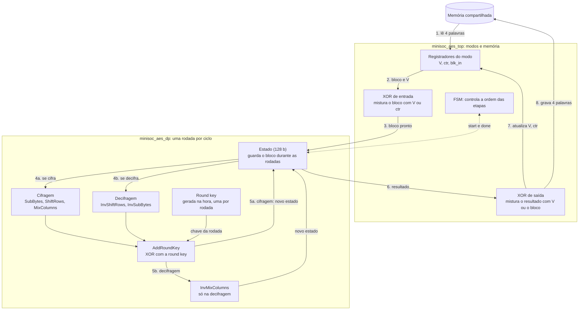
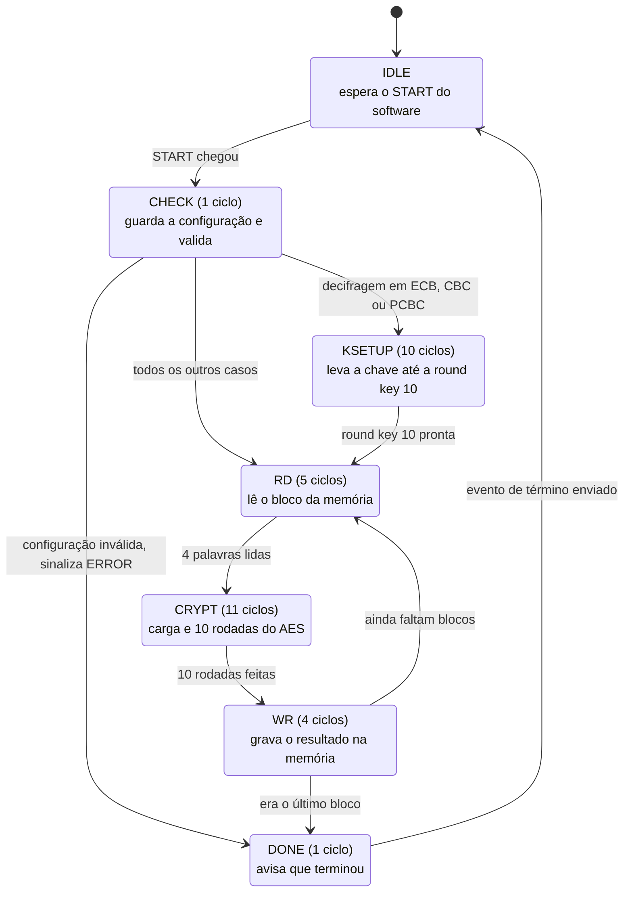

# MiniSoC AES — Microarquitetura v1.0

Semana 3 · Entrega: 06/11/2026 · Referência: Block Guide MiniSoC AES v1.0.0 · FIPS-197

Este documento fixa **como** o `minisoc_aes_top` e o `minisoc_aes_dp` serão implementados. As interfaces de topo, os arquivos, o mapa de registradores e o protocolo SPI vêm do Block Guide e não são repetidos aqui. Onde o guia é omisso, a decisão tomada está marcada como **[A confirmar]** e reunida na seção 8.

## 1. Decisões

| Tema | Decisão | Alternativa descartada |
|---|---|---|
| Microarquitetura do AES | **Iterativa, uma rodada por ciclo**: um só estado de 128 bits e uma só lógica de rodada, reutilizada nas 10 rodadas | Desenrolada (10 rodadas combinacionais): cerca de 2× mais rápida por bloco (ver seção 4.3), mas com ~10× a lógica de rodada e um caminho crítico ~10× mais longo, o que limitaria a frequência de `sys_clk`. Datapath de 32 bits: menor, mas pelo menos 4× mais ciclos de cálculo |
| Decifragem | **Cifra inversa direta** (FIPS-197, Fig. 12): InvShiftRows → InvSubBytes → AddRoundKey → InvMixColumns. Usa as round keys como estão, e os valores do Apêndice C.1 conferem rodada a rodada | Cifra inversa equivalente (Fig. 15): estrutura igual à da cifragem, mas exige InvMixColumns nas round keys |
| Round keys | **Em tempo real**, uma por ciclo, no `minisoc_aes_key_exp`, que sabe andar nos dois sentidos | Guardar as 11 round keys (1408 flops): elimina o passo inverso, mas custa área e potência |
| Modos de operação | Encadeamento fora do datapath: `minisoc_aes_top` faz as XORs de entrada e de saída; `minisoc_aes_dp` só cifra ou decifra um bloco | Modos dentro do `dp` |
| Registradores de status | `BUSY`, `DONE`, `ERROR` e o valor final de `BLOCKS_DONE` ficam no domínio **clk** (always-on) | Ficar no domínio `sys_clk`: o status seria apagado se o PLL fosse desligado depois do término |
| CDC | Toggle + 2 flops para eventos, Gray + 2 flops para o contador, quasi-estático para a configuração | Handshake de 4 fases: desnecessário com `spi_sclk` ≤ 25 MHz contra `clk` de 2 GHz |

## 2. Domínios de clock

- `spi_sclk` (até 25 MHz): recepção do quadro SPI e deslocamento do MISO.
- `clk` (2 GHz, always-on): decodificação SPI, banco de registradores, status, PLL mock, sincronizadores e controle de reset.
- `sys_clk` (PLL, 250 MHz a 2 GHz): `minisoc_aes_top`, `minisoc_aes_dp` e `minisoc_aes_key_exp`.
- `mem_clk` (até 200 MHz): interface MEMORY DATA, quando o usuário é dono da memória.

O guia não define onde fica o mux de dono da porta da memória (no `minisoc_top` ou dentro de `minisoc_memory`); para o AES tanto faz. A seleção de clock da porta (`mem_clk` ou `sys_clk`) é um mux simples em RTL, adequado ao modelo; um mux sem glitch é assunto de implementação física, e só se troca de dono com o AES ocioso (guia, 7.2).

## 3. Interior do motor AES

Como ler: os números seguem o caminho de um bloco, da memória (1) até voltar à memória (8). Em 4 a 5 o bloco gira por 10 rodadas, e a seta pontilhada é só controle (a FSM manda `start` e recebe `done`).

**Termos do diagrama.**

O AES cifra um bloco de 16 bytes por vez. Se cada bloco fosse cifrado sozinho (modo ECB), blocos iguais gerariam saídas iguais e o texto deixaria padrões à mostra. Os outros modos resolvem isso misturando cada bloco com algo que depende dos blocos anteriores. Esse "algo" é o que a RTL precisa guardar, e é daí que vêm os termos abaixo.

- **IV (vetor de inicialização).** Um valor de 128 bits que o software escreve antes do START. Ele existe para o primeiro bloco ter "algo anterior" com que se misturar. Em ECB não é usado.
- **`V`.** O registrador de 128 bits em que o `top` guarda esse "algo anterior". No começo vale o IV. A cada bloco é atualizado e, no bloco seguinte, entra no cálculo. O que vai para `V` depende do modo (coluna "Próximo `V`" da tabela de modos). Em CBC, por exemplo, `V` recebe o bloco cifrado que acabou de sair.
- **`ctr`.** Contador de 64 bits, só do modo CTR. Nesse modo o AES não cifra os dados: ele cifra `V ^ ctr` e faz XOR do resultado com os dados. `ctr` sobe 1 a cada bloco, então cada bloco usa uma entrada diferente.
- **`blk_in`.** Uma cópia do bloco lido da memória. O resultado é gravado **no mesmo endereço**, então o bloco original seria apagado. Na decifragem de CBC, PCBC e CFB o bloco cifrado original ainda é necessário para calcular o próximo `V`, e `blk_in` guarda esse valor.
- **`blk_done`.** Sinal do `dp` para o `top`, que vale 1 por um ciclo quando as 10 rodadas terminaram e `blk_o` tem o resultado. É ele que faz a FSM sair de CRYPT para WR.
- **`key_ready`.** Sinal do `dp` que indica que a round key 10 está pronta em `key_base`. Só importa na decifragem de ECB, CBC e PCBC, que começa pela última chave. Ele encerra o KSETUP.

**Exemplo: um bloco em CBC, cifrando.**

1. RD lê o bloco `P` da memória (4 palavras) e o guarda em `blk_in`.
2. O XOR de entrada calcula `P ^ V` e entrega o resultado ao `dp`.
3. CRYPT: o `dp` carrega o bloco, faz as 10 rodadas e ativa `blk_done` com `C = E(P ^ V)`.
4. WR grava `C` na memória no lugar de `P` e atualiza `V ← C`.
5. No bloco seguinte, o passo 2 usa esse `V` novo: é o encadeamento.

Na decifragem de CBC o caminho é outro: o `dp` decifra `C` e o XOR de saída faz `D(C) ^ V`. Por isso `blk_in` precisa ter guardado `C`, que vira o próximo `V` depois que a memória é sobrescrita com o texto original.

**Rodada, por ciclo.** `r` conta de 1 a 10 e `rk` é a round key da rodada.

| Sentido | Rodadas 1 a 9 | Rodada 10 |
|---|---|---|
| Cifragem | `state ← AddRoundKey(MixColumns(ShiftRows(SubBytes(state))), rk[r])` | igual, sem MixColumns |
| Cifra inversa | `state ← InvMixColumns(AddRoundKey(InvSubBytes(InvShiftRows(state)), rk[10−r]))` | igual, sem InvMixColumns |

Há um único `AddRoundKey`: MixColumns vem antes dele na cifragem e InvMixColumns depois dele na inversa, e a rodada final desvia essas transformações. Os módulos combinacionais são os da Semana 2 e desta semana. O estado inicial é `state ← blk_i ^ rk0` (cifragem) ou `blk_i ^ rk10` (inversa), carregado no ciclo de `blk_start`.

**Round keys.** `minisoc_aes_key_exp` é um passo combinacional bidirecional, com as mesmas 4 S-boxes (SubWord) nos dois sentidos:

- Direto, de `rk[r−1]` para `rk[r]`: `w0' = w0 ^ SubWord(RotWord(w3)) ^ Rcon[r]`, `w1' = w1 ^ w0'`, `w2' = w2 ^ w1'`, `w3' = w3 ^ w2'`.
- Inverso, de `rk[r]` para `rk[r−1]`: `w3 = w3' ^ w2'`, `w2 = w2' ^ w1'`, `w1 = w1' ^ w0'`, `w0 = w0' ^ SubWord(RotWord(w3)) ^ Rcon[r]`.

Os dois sentidos foram conferidos em Python contra a expansão da FIPS-197 (`rk0 → rk10` e de volta). Na decifragem o `dp` precisa de `rk10` antes da primeira rodada: `key_load` executa 10 passos diretos (fase **KSETUP**, 10 ciclos) e guarda `rk10` em `key_base`. Isso é feito **uma vez por operação**, não por bloco, porque a chave é capturada no START (guia, 8.3). A cada bloco `rk_cur` volta a `key_base`.

**Interface proposta do `dp`** (a fechar na implementação do módulo): `clk_i`, `rst_n_i`; `key_load_i`, `decrypt_i`, `key_i[127:0]`, `key_ready_o`; `blk_start_i`, `blk_i[127:0]`, `blk_o[127:0]`, `blk_done_o`, `busy_o`.

**Modos.** `minisoc_aes_top` monta a entrada do `dp` e trata a saída. `V` guarda IV e encadeamento. `E` e `D` são a cifragem e a decifragem de um bloco.

| MODE | Primitiva | Entrada do `dp` | Saída gravada na memória | Próximo `V` |
|---|---|---|---|---|
| 000 ECB | E ou D | bloco lido | saída do `dp` | |
| 001 CBC | E ou D | cifra: `P ^ V`; decifra: `C` | cifra: `E(...)`; decifra: `D(C) ^ V` | `C` (o texto cifrado do bloco) |
| 010 PCBC | E ou D | cifra: `P ^ V`; decifra: `C` | cifra: `E(...)`; decifra: `D(C) ^ V` | `P ^ C` |
| 011 CFB | sempre E | `V` | `bloco ^ E(V)` | `C` |
| 100 OFB | sempre E | `V` | `bloco ^ E(V)` | `E(V)` |
| 101 CTR | sempre E | `V ^ {64'b0, ctr}` | `bloco ^ E(...)` | `V` fixo; `ctr + 1` |

Duas consequências para a RTL. Como o resultado é gravado **no lugar**, `C` precisa ser guardado antes de ser sobrescrito: por isso existe `blk_in`, que alimenta `V` na decifragem de CBC, PCBC e CFB. E o sentido inverso só é exigido em ECB, CBC e PCBC.

## 4. FSM do `minisoc_aes_top`

**Visão em 5 passos.** A FSM completa (abaixo) é a mesma coisa vista com mais detalhe:

| Passo | Estados | O que acontece |
|---|---|---|
| 1. Ler | RD | Lê o bloco da memória (4 palavras de 32 bits) |
| 2. Preparar a chave | CHECK, KSETUP | Valida a configuração e, só na decifragem de ECB, CBC e PCBC, leva a chave até a round key 10 |
| 3. Rodadas | CRYPT | Carga e 10 rodadas, uma por ciclo |
| 4. Escrever | WR | Grava o resultado no mesmo endereço |
| 5. Fim | DONE | Avisa o término (ou o erro) |

Os passos 1, 3 e 4 se repetem por bloco. O passo 2 acontece uma vez por operação.

| Estado | Ciclos | O que faz |
|---|---|---|
| IDLE | | Espera `start_sys`. Nada é capturado fora dele. |
| CHECK | 1 | Captura KEY, IV, COUNTER, MODE, DECRYPT e NUM_BLOCKS (guia, 8.3). Valida `MODE ≤ 101` e `1 ≤ NUM_BLOCKS ≤ 256`. Emite `key_load` ao `dp`. |
| KSETUP | 10 | Só na decifragem de ECB, CBC e PCBC. |
| RD | 5 | Endereços `base+0..3` em 4 ciclos, mais 1 de latência da leitura síncrona. Monta `blk_in`. |
| CRYPT | 11 | `blk_start`, 1 ciclo de carga e 10 rodadas. Aplica o XOR de entrada antes e o de saída depois. A rodada 10 é a final: o `dp` seleciona o caminho sem (Inv)MixColumns quando `r = 10`, sem estado separado. |
| WR | 4 | Grava 1 palavra por ciclo em `base+0..3`, atualiza `V`, `ctr`, `base += 4` e `blocos_feitos`. |
| DONE | 1 | Emite o evento de término (e de erro, se houver). |

Por que a chave é gerada na hora e não pré-computada: guardar as 11 round keys custa 1408 flops (176 bytes) e uma fase de expansão, e refazê-la a cada bloco desperdiça ciclos. Gerar uma round key por ciclo no `key_exp` não gasta ciclo extra na cifragem, e na decifragem custa só os 10 ciclos de KSETUP, uma vez por operação.

### 4.1 Memória e endereçamento
A porta é única (LIM-MEM-01), então leitura e escrita não se sobrepõem. Bloco `i` ocupa `4i .. 4i+3`, com a palavra 0 em `[127:96]` (guia, 7.1).

### 4.2 Sinais de controle e status
`start_sys`, `finish_evt` e `err` cruzam como descrito na seção 5. `BUSY` sobe no domínio `clk` no instante em que o START é aceito, e `DONE` é limpo nesse mesmo instante. Assim o software nunca lê `DONE` antigo logo depois do START. No término, o valor final de `BLOCKS_DONE` é congelado no domínio `clk`, então o status sobrevive ao desligamento do PLL.

### 4.3 Desempenho (estimativa por contagem de estados, não medida)
Por bloco: 5 + 11 + 4 = **20 ciclos de `sys_clk`**, mais cerca de 1 de controle. Por operação: 1 (CHECK) e, na decifragem de ECB, CBC e PCBC, +10 de KSETUP. Uma versão desenrolada reduziria CRYPT de 11 para 1 ciclo, isto é, 10 por bloco: o ganho é limitado a cerca de 2× porque 9 dos 20 ciclos são de acesso à memória. A síntese (Semanas posteriores) dirá se uma rodada fecha na frequência desejada; a hipótese é que o caminho crítico seja o da decifragem (InvSubBytes, XOR de chave e InvMixColumns, este com três `xtime` em série).

## 5. Cruzamento de domínios (CDC)

| # | Cruzamento | Técnica | Por que é seguro |
|---|---|---|---|
| 1 | Quadro SPI, `spi_sclk` → `clk` | **Toggle** (guia, 5.3) | Ver 5.1 |
| 2 | Valor lido, `clk` → `spi_sclk` | `rdata_q` quasi-estático | Só muda ao chegar um pedido de leitura, ≥ 1 quadro (1,6 µs a 25 MHz) antes de ser deslocado |
| 3 | START, `clk` → `sys_clk` | Toggle + 2 flops | Pulso de 1 ciclo de `clk` não pode ser perdido por `sys_clk` mais lento |
| 4 | Término e erro, `sys_clk` → `clk` | Toggle + 2 flops; `err` é nível estável | `err` é escrito antes do toggle virar |
| 5 | `BLOCKS_DONE`, `sys_clk` → `clk` | **Gray** de 9 bits + 2 flops | Só 1 bit muda por incremento (0 a 256 cabem em 9 bits) |
| 6 | Configuração, `clk` → `sys_clk` | Quasi-estático, capturada em CHECK | O software escreve a configuração ≥ 1 quadro antes do START; restrição de SDC a definir na síntese |
| 7 | `PLL_LOCKED` → reset do `sys_clk` | Sincronizador de reset (seção 6) | Assert assíncrono e deassert síncrono |

### 5.1 Quadro SPI por toggle

Em `spi_sclk`, a 40ª borda de subida deixa `rx_frame` estável e inverte `frame_tog`. Em `clk`, dois flops sincronizam o toggle, um terceiro detecta a borda (`frame_pulse`) e, no ciclo seguinte, `frame_q` captura `rx_frame`. Daí o quadro é decodificado (RWb, ADDR, DATA).

Janela de estabilidade: depois da 40ª borda, `rx_frame` só muda na primeira borda de subida do quadro seguinte, no mínimo 1 período de `spi_sclk` (40 ns a 25 MHz) depois. A captura precisa de no máximo 4 ciclos de `clk` (2 flops, detecção de borda e o ciclo extra de margem), isto é, 2 ns: uma folga de cerca de 20×. Por isso não há handshake. O contador de bits é zerado enquanto `spi_cs_n = 1`, e um quadro com menos de 40 bordas é descartado. **[A confirmar]** que `spi_cs_n` fica estável antes da primeira borda de subida.

Escrita: uma transação. Leitura: o primeiro quadro (`RWb = 1`) carrega `rdata_q` com o registrador de `ADDR`, e o segundo (`ADDR = 0x3F`, NOP) desloca `rdata_q` pelo MISO. O valor lido é o do instante do pedido.

## 6. Sequência de reset do domínio do sistema (guia, 4.2)

Dois resets derivados de `rst_n`:

- `rst_ctrl_n` (domínio `clk`): assert assíncrono por `rst_n`, deassert sincronizado a `clk` (2 flops). Reinicia o banco de registradores, o PLL, `MEM_SEL_AES`, os sincronizadores e o status.
- `rst_sys_n` (domínio `sys_clk`): sincronizador de reset de `SYS_RST_CYCLES` flops (padrão 4) em `sys_clk`, com clear assíncrono por `rst_n & pll_locked`.

| Passo | Condição | Efeito |
|---|---|---|
| 1 | `rst_n = 0` | Os dois domínios entram em reset de imediato, mesmo com `sys_clk` parado. `PLL_ENABLE = 0`, `MEM_SEL_AES = 0`: a memória é do usuário. A memória não é apagada. |
| 2 | `rst_n` sobe | `rst_ctrl_n` solta após 2 ciclos de `clk` e o SPI já atende. `rst_sys_n` continua ativo, pois `locked = 0`. |
| 3 | Software habilita o PLL | Após o atraso pseudoaleatório do mock, `locked` sobe e `sys_clk` é liberado. |
| 4 | `locked = 1` | O clear assíncrono do sincronizador é liberado. Os `SYS_RST_CYCLES` primeiros flancos de `sys_clk` empurram o `1` pela cadeia. |
| 5 | Após `SYS_RST_CYCLES` flancos | `rst_sys_n` sobe, de forma síncrona e determinística. A FSM está em IDLE. |

Se `locked` cair (PLL desabilitado), `rst_sys_n` é imposto de novo de forma assíncrona (não há clock para amostrar). Registradores de dados do `dp` (`state`, `rk_cur`, `key_base`, `blk_in`, `V`) **não** têm reset: são escritos antes de qualquer uso (carga em CHECK e RD) e nada é gravado na memória antes disso. Só a FSM e os contadores são reiniciados.

## 7. Entregável e verificação da semana

RTL: `rtl/minisoc_aes_mix_columns.sv`, `inv_mix_columns`, `add_round_key`, `inv_shift_rows`, `inv_sbox`, `inv_sub_bytes`. Teste: `tb/tb_minisoc_aes_week3.sv` (ver `docs/reports/semana_03.md`).

Itens que o verificador parceiro pode levar para o plano de verificação:

- `BUSY` e `DONE` nunca valem 1 ao mesmo tempo, e `DONE = 0` no ciclo seguinte a um START aceito.
- `BLOCKS_DONE` é monotônico durante a operação e termina igual a `NUM_BLOCKS` (ou 0, se `ERROR`).
- Só um mestre aciona a porta da memória; `MEM_SEL_AES` não muda com `BUSY = 1`.
- `rst_sys_n` só sobe `SYS_RST_CYCLES` flancos de `sys_clk` depois de `locked`.
- Cobertura cruzada: 6 modos × cifra/decifra × `NUM_BLOCKS ∈ {1, 2, 256}` × 4 divisores do PLL; erros com `NUM_BLOCKS ∈ {0, 257}` e `MODE ∈ {110, 111}`; quadros SPI consecutivos sem espaço; START perto de `locked`.
- Corner: PLL desabilitado com `BUSY = 1`.

## 8. Pontos em aberto para a defesa

1. **START inválido** (sem `locked`, com `MEM_SEL_AES = 0` ou com `BUSY = 1`): o guia não diz. Proposta: **ignorar**, sem efeito. Sem isso, um START feito antes do lock ficaria pendente no toggle e dispararia a operação ao sair do lock.
2. **ERROR e DONE:** com configuração inválida, o guia fala em "encerrar a operação". Proposta: `ERROR = 1` **e** `DONE = 1`, com `BLOCKS_DONE = 0`, para que o laço de espera por `DONE` (guia, seção 9) termine.
3. **Latência da memória:** assumido 1 ciclo de leitura síncrona na porta, com a porta no `sys_clk` quando o AES é dono. Conferir em `minisoc_memory.sv`.
4. **MISO:** em qual parte do segundo quadro sai o valor lido. Assumido: durante o campo DATA, nas últimas 32 bordas.
5. **Valores de reset** dos registradores, inclusive `PLL_DIV_SEL`: o guia não lista. Assumido zero em todos.
6. **Escrita de configuração com `BUSY = 1`:** assumido aceita e vale só para a próxima operação, já que o engine captura tudo no START.
7. **CTR:** "contador de 64 bits zero-extendido" interpretado como `{64'b0, ctr}` em `[63:0]` do IV, com `ctr` em `COUNTER_HI:COUNTER_LO` e o incremento por bloco.
8. **Desligar o PLL com `BUSY = 1`:** a operação é abortada em silêncio (o `sys_clk` para e o `rst_sys_n` volta). Proposta: tratar como uso indevido e cobrir no plano de verificação.
